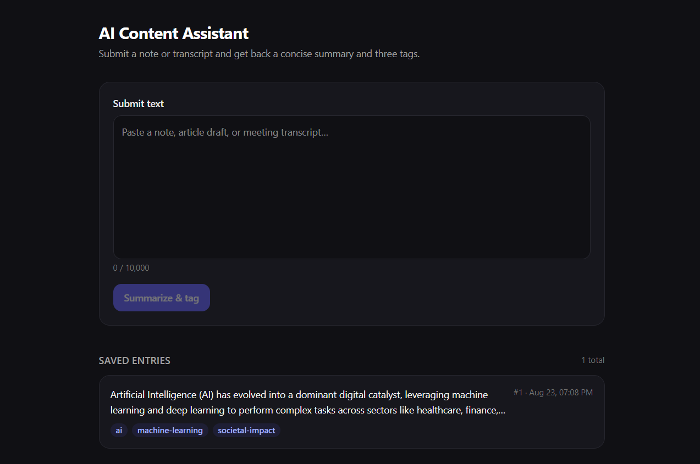

# AI Content Assistant

Submit a block of text (note, article draft, meeting transcript) and get back a **concise summary** plus **exactly three tags**, generated by Google Gemini, validated, persisted to SQLite, and viewable in the UI.



## Stack

| Layer    | Choice                                        |
| -------- | --------------------------------------------- |
| Frontend | Next.js 16 (App Router) + Tailwind CSS v4     |
| Backend  | Python FastAPI + uvicorn                      |
| Database | SQLite (file-based, survives restarts)        |
| LLM      | Google Gemini (`gemini-2.5-flash` via REST)   |

## Running locally

**Prereqs:** Python 3.12+, Node 18+ / npm, and a Gemini API key ([aistudio.google.com/apikey](https://aistudio.google.com/apikey)).

**1. Backend**

```bash
cd backend
python -m venv .venv
.venv\Scripts\activate                          # Windows  (Linux/macOS: source .venv/bin/activate)
pip install -r requirements.txt
copy .env.example .env                          # then paste your GEMINI_API_KEY into .env

# start dev server (auto-reload)
python -m uvicorn app.main:app --reload --port 8000

# start production server (no auto-reload)
python -m uvicorn app.main:app --port 8000

# run tests
python -m pytest
```

**2. Frontend** (second terminal)

```bash
cd frontend
npm install
npm run dev                                 # http://localhost:3000
```

The SQLite file is created automatically at `backend/data/app.db` on first run. Configuration lives in `backend/.env` (see `.env.example` for variable names).

## API

| Endpoint             | Method | Purpose                                            |
| -------------------- | ------ | -------------------------------------------------- |
| `/entries`           | POST   | Validate text → summarize/tag via Gemini → persist |
| `/entries`           | GET    | List saved entries (newest first)                  |
| `/entries/{id}`      | GET    | Single entry detail                                |
| `/health`            | GET    | Liveness check                                     |

Tests: `cd backend && python -m pytest` (16 tests: validation, persistence, AI failure paths, response parsing).

## Notes

### Architecture

Next.js client posts `{ text }` to FastAPI (`POST /entries`). The backend validates input (non-empty, ≤10k chars), calls Gemini's `generateContent` REST endpoint with an instruction to return strict JSON (`responseMimeType: application/json`, temperature 0.2). The raw model text is extracted from `candidates[0]`, stripped of markdown fences if present, parsed with `json.loads`, and normalized into a Pydantic `AIResult(summary, tags[3])`. Valid results are inserted into SQLite (tags serialized as JSON) and returned as `201` with the stored entry; any AI failure surfaces as a `502` with a readable message instead of crashing.

### AI choice

Gemini 2.5 Flash was used because it is fast, cheap, has native JSON response mode, and requires only an API key — no cloud project setup. The prompt pins the exact JSON shape and forbids extra keys/commentary; the parser still validates defensively rather than trusting the model.

### Reliability

Timeouts (20s default), HTTP errors, non-JSON bodies, malformed JSON, wrong shapes (missing summary / ≠3 tags / empty tags) are each caught explicitly and mapped to a `502` with a specific message; failed requests never write to the database. Tests cover each path with mocked provider responses.

### Privacy

Only the raw submitted text and static prompt instructions are sent to Google. In a financial-services environment I would avoid sending customer PII/account data, and would instead prefer a self-hosted/open-weights model or an enterprise agreement with zero-retention guarantees, redaction before inference, and audit logging of every outbound call.

### Production next steps

- Retry with exponential backoff + idempotency keys on `POST /entries`, so transient AI failures can be retried safely.
- Structured logging/metrics (request IDs, latency, token usage) and rate limiting per client.
- Containerize both apps behind one reverse proxy, CI running lint/typecheck/tests on PR.

### AI coding tools

Built using opencode (AI coding agent) as the primary implementation assistant. All generated code was reviewed and adjusted by hand (e.g., database location, Tailwind v4 wiring, error-mapping structure); correctness was verified with the automated pytest suite and manual end-to-end runs against the real Gemini API.
